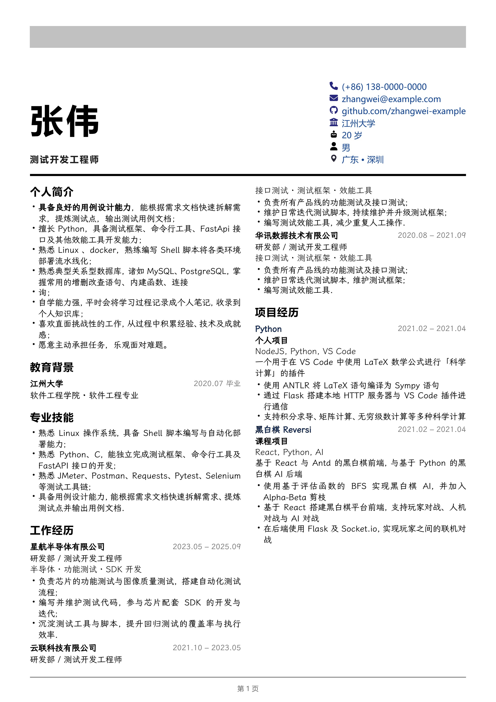

# Resume

使用 Typst 编写的简历.

版式上, 采用**报刊 / 杂志**的编辑设计风格 (参考 `examples/HUMr1GmWsAAu9_8.jpeg`):

- 页眉左上角为标识, 右上角为浅灰色块 (可换成照片), 色块下方为右对齐的日期;
- 中部为超大无衬线粗体姓名 + 小字号字距拉开的副标题;
- 姓名右侧的空白处放置联系方式 (电话 / 邮箱 / GitHub 等), 右对齐;
- 标题下方一条加粗的黑色通栏分隔线;
- 分隔线之下为一段导语, 概括个人定位;
- 正文为两栏排版的衬线字体, 栏目标题为无衬线粗体;
- 页脚为一条细分隔线 + 居中显示的姓名与页码.

语法上, 基于以下 Typst 的设计原则编写 (简洁一致与组合原则):

> - **Simplicity through Consistency:** If you know how to do one thing in Typst, you should be able to transfer that knowledge to other things. If there are multiple ways to do the same thing, one of them should be at a different level of abstraction than the other. E.g. it's okay that `= Introduction` and `#heading[Introduction]` do the same thing because the former is just syntax sugar for the latter.
> - **Power through Composability:** There are two ways to make something flexible: Have a knob for everything or have a few knobs that you can combine in many ways. Typst is designed with the second way in mind. We provide systems that you can compose in ways we've never even thought of. TeX is also in the second category, but it's pretty low-level and therefore people use LaTeX instead. But there, we don't really have that much composability. Instead, there's a package for everything (\usepackage{knob}).

## 使用

### 新建一份简历

`resume-template-zh.typ` 是模板 (内容均为示例数据). 新建简历时, 先将其复制为 `resume.typ`, 再在 `resume.typ` 上修改:

```powershell
Copy-Item resume-template-zh.typ resume.typ
```

### 在线编辑

可以使用 Typst 的 Web App,

模板链接: https://typst.app/

### 本地编辑（推荐）

- 安装 VS Code，以及 Tinymist Typst 和 Typst Preview 插件。
- 打开 `resume.typ` 文件，按下 `Ctrl + K V` 快捷键后即可显示与编辑。
- 按下 `Shift + Ctrl + P` 后执行 `Typst: Export the currently open file as PDF` 即可导出 PDF 文件。

### 命令行编译

仓库根目录附带了 `compile.ps1` (本机已装好 Typst CLI), 在项目目录执行:

```powershell
cd D:\myworkspace\Chinese-Resume-in-Typst
./compile.ps1          # 编译 resume.typ 并生成 resume.pdf
```

也可以直接调用 typst (需在项目目录或加 `--root`, 以保证 `template.typ`、`icons/` 等相对路径正确解析):

```powershell
typst compile resume.typ resume.pdf --root .
```

## 效果



## 示例

你可以使用 **简洁** 与 **组合式** 的语法出美观的效果.

```typst
// 设置简历选项与页眉
#show: resume.with(
  // 字体基准大小
  size: 10pt,
  // 主题色 (链接 / 页脚)
  themeColor: rgb(20, 69, 148),
  // 控制纸张的边距
  marginTop: 1.1cm,
  marginBottom: 1.5cm,
  marginLeft: 1.27cm,
  marginRight: 1.27cm,

  // ---- 页眉左侧标识 ----
  brand: "个人简历",
  brandIcon: "icons/fa-user.svg",
  // 若希望标识可点击, 取消下一行注释
  // brandLink: "https://github.com/zhangwei-example",

  // ---- 页眉右上角: 灰色色块 (可换成照片) 与日期 ----
  // 若不需要色块, 把 bannerHeight 设为 0em 即可
  // banner: "profile.jpg",
  // 灰色块内的文字 (设置 banner 图片时不显示)
  bannerText: "测试开发工程师",
  bannerWidth: 31%,
  bannerHeight: 2.6em,
  date: "2025 年 11 月",

  // ---- 大标题与副标题 ----
  title: "张伟",
  titleSize: 4em,
  titleTracking: 0.08em,
  subtitle: "测试开发工程师 · TEST DEVELOPMENT ENGINEER",
  subtitleSize: 1.05em,
  subtitleTracking: 0.14em,

  // ---- 姓名右侧的联系信息 ----
  headerInfo: info(
    color: themeColor,
    // 对齐方式: left (左对齐) / right (右对齐)
    alignment: left,
    size: 1em,
    (
      // 其实 icon 也可以直接填字符串, 如 "icons/fa-phone.svg"
      icon: faPhone,
      content: "(+86) 138-0000-0000"
    ),
    (
      icon: faEnvelope,
      content: "zhangwei@example.com",
      link: "mailto:zhangwei@example.com"
    ),
    (
      icon: faGithub,
      content: "github.com/zhangwei-example",
      link: "https://github.com/zhangwei-example",
    ),
    (
      icon: faBuildingColumns,
      content: "江州大学",
    ),
    (
      icon: faUser,
      content: "26 岁 · 求职意向: 测试开发",
    ),
  ),

  // ---- 标题下方的粗分隔线 ----
  ruleWidth: 100%,
  ruleThickness: 2.5pt,

  // ---- 正文分栏 ----
  columnCount: 2,
  gutter: 0.6cm,

  // ---- 页脚 ----
  footer: "张伟",
)[

// ---- 导语: 一段话概括个人定位 ----
*测试开发工程师*，具备半导体与互联网行业的测试开发经验，擅长功能测试、接口测试与测试框架建设，能独立使用 Python 完成自动化测试流程、效能工具与 FastAPI 接口的开发。

== 教育背景

#item(
  [ *江州大学* ],
  [ 软件工程学院 · 软件工程专业 ],
  date[ 2020.07 ]
)
]
```

以及每一个块

```typst
== 专业技能

- 熟悉 Linux 操作系统, 具备 Shell 脚本编写与自动化部署能力;
- 熟悉 Python、C, 能独立完成测试框架、命令行工具及 FastAPI 接口的开发.
```

```typst
== 工作经历

#item(
  [ *星航半导体有限公司* ],
  [ 研发部 / 测试开发工程师 ],
  date[ 2023.05 – 2024.05 ]
)

#tech[ 半导体 · 功能测试 · SDK 开发 ]

- 负责芯片的功能测试与图像质量测试, 搭建自动化测试流程.
```

联系方式通过 `headerInfo` 参数放在姓名右侧; 若希望放在正文中, 也可以去掉 `headerInfo`, 在正文使用 `#info(...)` 与 `== 联系方式` 栏目.
正文各栏默认顺序填充; 若希望强制在某处换栏, 可使用 `#colbreak()`.

## 参考

- [OrangeX4/Chinese-Resume-in-Typst](https://github.com/OrangeX4/Chinese-Resume-in-Typst)
